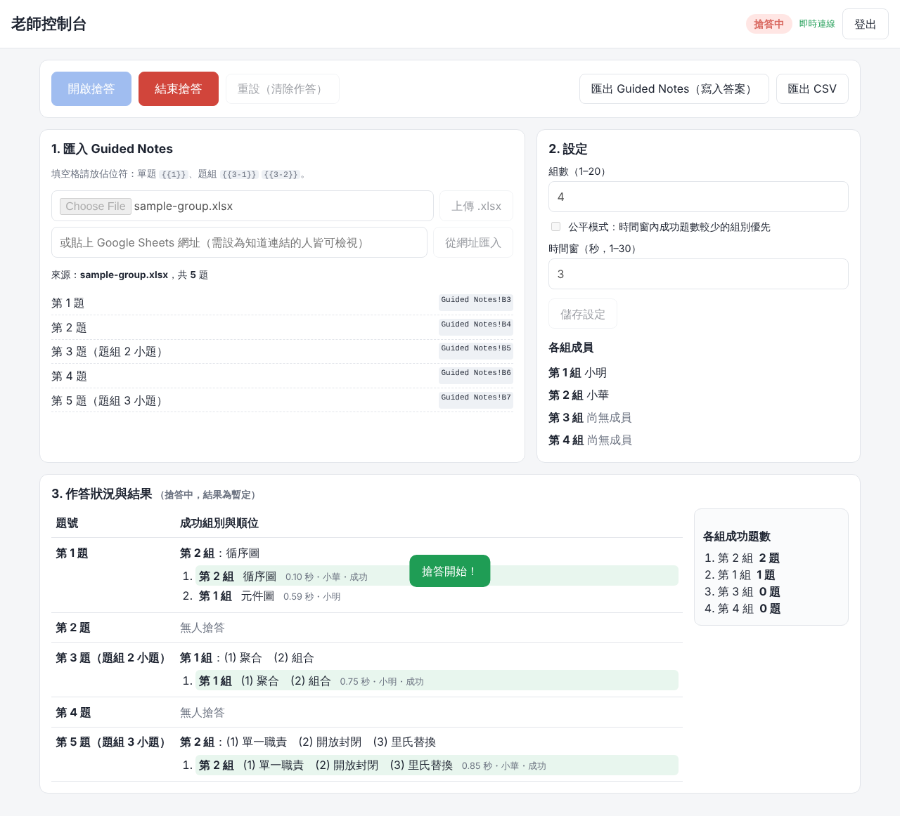

# 課堂搶答系統（OpenSpec 組）

2026 軟體工程期末專題：Vibe Coding 課堂搶答系統。用 **OpenSpec** 規格驅動流程（Explore → Propose → Apply → Verify → Sync → Archive），以 AI 代理完成。

老師匯入 Guided Notes（填空式學習單），開啟搶答；各組學生線上送出答案，系統以伺服器收到的先後判定每題最快的組別；結束後老師可把成功答案寫回原 Guided Notes 的填空格，並匯出 CSV。



## 功能

| 類別 | 功能 |
|------|------|
| 核心 | 老師／學生兩種角色（老師通行碼、學生選組加入） |
| 核心 | 匯入 Guided Notes（上傳 .xlsx 或貼 Google Sheets 網址），題數與 Guided Notes 一致，只用題號 |
| 核心 | 開啟、結束搶答；所有頁面即時同步活動階段（WebSocket，實測 < 0.1 秒） |
| 核心 | 學生以組別送出答案；每組每題只能送一次；最快送出者搶答成功 |
| 核心 | 搶答結束前學生看不到其他組任何資訊；老師即時看到所有作答與暫定結果 |
| 核心 | 匯出：把成功答案寫進原 Guided Notes 的填空格（保留格式） |
| 額外 | 題組：一個題組有多個填空，必須同時送出 |
| 額外 | 匯出 CSV（題號、小題、組別、答案、搶答順位、是否成功、送出秒數） |
| 額外 | 公平模式：第一份答案送達後 N 秒內送出的組別中，成功題數較少者優先 |
| 額外 | 各組成功題數統計、重設再玩一輪、手機版畫面 |

## 安裝與啟動

需要 Python 3.10 以上。

```bash
python -m venv .venv
```

Windows：

```bash
.venv\Scripts\activate
```

macOS / Linux：

```bash
source .venv/bin/activate
```

```bash
pip install -r requirements.txt
```

```bash
python -m app.main
```

終端機會顯示網址與**老師通行碼**（每次啟動隨機產生）：

```
====================================================
  課堂搶答系統已啟動：http://127.0.0.1:8000
  老師通行碼：482913
====================================================
```

想固定通行碼可設定環境變數 `TEACHER_PASSCODE`（Windows CMD：`set TEACHER_PASSCODE=1234`；PowerShell：`$env:TEACHER_PASSCODE="1234"`）。通行碼不會寫進 repo。

## 在一台電腦模擬老師與多組學生

身分存在**分頁**裡，所以同一個瀏覽器開多個分頁即可：

1. 分頁 A 開 `http://127.0.0.1:8000` → 老師登入。
2. 分頁 B 開同一網址 → 名字「小明」、第 1 組。
3. 分頁 C 開同一網址 → 名字「小華」、第 2 組。

## Guided Notes 格式規範（佔位符）

在 Google Sheets 的填空格中放入佔位符，系統會掃描**所有工作表、所有儲存格**，不依賴固定位置：

| 類型 | 寫法 | 範例 |
|------|------|------|
| 單題 | `{{題號}}` | `牛頓第一定律又稱為 {{1}} 定律` |
| 題組 | `{{題號-小題號}}` | `空心菱形代表 {{3-1}}，實心菱形代表 {{3-2}}` |

規則：題號從 1 開始連續；題組小題號從 1 開始連續；同一佔位符只能出現一次；同一題不能同時是單題和題組。違反時系統會顯示原因並保留原題目。佔位符可以和題目文字放在同一格，也可以單獨一格。

範例檔：執行 `python samples/make_samples.py` 產生（repo 內已附）：

- `samples/sample-single.xlsx`：5 題單題
- `samples/sample-group.xlsx`：3 題單題＋2 個題組
- `samples/sample-moved.xlsx`：佔位符分散在兩個工作表、不同欄位（測試「非固定位置」）

## 與 Google Sheets 搭配

**匯入（二選一）**
- 方法 1：Google Sheets →「檔案 → 下載 → Microsoft Excel (.xlsx)」→ 在老師頁上傳。
- 方法 2：Google Sheets 右上「共用」→「一般存取權」設為「知道連結的任何人：檢視者」→ 複製網址貼到老師頁「從網址匯入」。

**匯出寫回**
1. 搶答結束後按「匯出 Guided Notes（寫入答案）」下載 `.xlsx`。
2. 到原本的 Google Sheets →「檔案 → 匯入 → 上傳」→ 選剛下載的檔案 →「取代試算表」。

沒有人搶答成功的題目會保留 `{{題號}}`，方便辨識，也可再次匯入。

> 為什麼不直接改雲端檔案？直接寫回 Google Sheets 需要 Google API 金鑰／OAuth 憑證，作業規定不可洩漏金鑰，且只需本機執行，所以採用不需任何金鑰的下載／上傳方式。

## 公平模式

老師在「設定」勾選公平模式並設定時間窗（預設 3 秒）。各題依第一份答案送達的先後處理：第一份送達後時間窗內送出的組別都是候選，**候選中目前成功題數最少的組別成功**，同數時較早者成功。順位仍照送出先後顯示，CSV 的「是否成功」欄會反映公平模式的結果。

## Demo 流程（5 分鐘影片建議）

1. 啟動伺服器，展示終端機通行碼（約 20 秒）。
2. 老師登入、上傳 `sample-group.xlsx`，說明佔位符與題目位置清單（40 秒）。
3. 兩個分頁分別加入第 1 組、第 2 組，老師頁顯示成員（20 秒）。
4. 老師開啟搶答 → 兩個學生頁同時變成「搶答中」（20 秒）。
5. 第 2 組先送第 1 題、第 1 組後送；展示學生頁看不到別組，老師頁即時看到全部與順位（60 秒）。
6. 題組送出、展示空白／題組未填完被拒絕（40 秒）。
7. 老師結束搶答 → 學生頁同步顯示結果與成功題數（30 秒）。
8. 匯出 Guided Notes，打開檔案展示答案已寫進填空格；匯出 CSV（40 秒）。
9. 換上傳 `sample-moved.xlsx` 證明非固定位置；（可選）開公平模式再玩一輪（30 秒）。

## 測試

```bash
python -m pytest
```

共 50 個自動化測試，涵蓋 spec 中的情境：佔位符解析與驗證、寫回匯出、Google Sheets 網址、階段規則、送出規則、一般／公平模式判定、角色可見性、CSV、REST API 權限與 WebSocket 同步。人工驗證清單見 [docs/04-人工驗證清單.md](docs/04-人工驗證清單.md)。

## 專案結構

```
app/
  main.py          FastAPI 路由、WebSocket、啟動入口
  activity.py      活動狀態、送出規則、成功判定（含公平模式）
  reporting.py     結果彙整、依角色過濾的視圖、CSV
  guided_notes.py  佔位符解析、驗證、寫回匯出
  sheets_url.py    Google Sheets 網址下載（不需金鑰）
  static/          index / teacher / student 頁面
samples/           範例 Guided Notes 與產生腳本
tests/             pytest 測試
openspec/          OpenSpec 規格（specs/ 主規格、changes/archive/ 已封存的 change）
docs/              Explore 紀錄、流程紀錄、人工驗證清單、截圖
```

## 技術選擇

Python 3 + FastAPI + WebSocket（即時同步）、openpyxl（讀寫 xlsx）、原生 HTML/CSS/JavaScript。理由與替代方案見 `openspec/changes/archive/*/design.md`。

## 限制

- 資料只存在記憶體，伺服器重啟後清空（請在結束前匯出）。
- 只綁定 `127.0.0.1`，供本機模擬使用。
- 不判斷答案對錯，只看送出先後（公平模式另計）。
